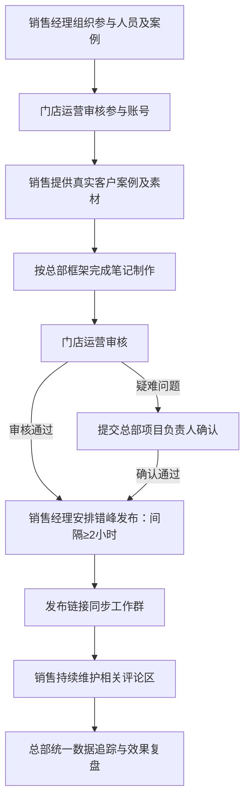
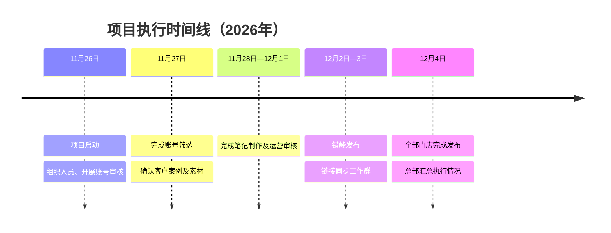

# 📘 新港集团小红书口碑内容矩阵执行SOP（讨论稿V1.0）

> 📅 **启动：2026年11月26日（周四）** ｜ 🏁 **全部发布完成：2026年12月4日（周五）**
>
> **真实案例支撑、成熟账号优先、运营统一审核、销售经理统筹、总部集中追踪。**

## 一、🎯 项目目标

针对小红书平台目前存在的集团及门店负面舆情，组织**四网已确定参与的门店**开展口碑内容建设。

以总部前期验证有效的提车日记为参考模板，结合各门店真实客户案例，制作具有个人分享风格的小红书笔记，逐步增加平台上的正向购车体验内容。

### 执行原则

**真实案例支撑、成熟账号优先、运营统一审核、销售经理统筹、总部集中追踪。**

## 二、👥 执行分工

| 责任人 | 工作职责 |
| --- | --- |
| **销售经理** | 组织销售参与、统筹账号及案例、控制发布时间、督促执行 |
| **销售人员** | 提供真实客户案例、整理购车经历及素材、配合笔记制作、维护相关评论 |
| **门店运营** | 判断账号质量、指导文案制作、审核笔记内容、汇总发布情况 |
| **总部项目负责人** | 提供内容框架、处理疑难审核问题、统一追踪数据、复盘效果 |

## 三、🔎 账号筛选要求

由销售经理组织销售部门寻找适合参与的账号，优先考虑**长期稳定、成熟可靠、熟悉门店业务**的销售人员提供案例和配合执行。

账号优先考虑销售本人或其家人已有的、正常使用的小红书账号。

### 账号筛选重点

| 筛选维度 | 执行标准 |
| --- | --- |
| **账号真实性** | 长期正常使用，具有自然的历史内容及互动记录。 |
| **账号稳定性** | 优先使用成熟账号，**不可新注册账号并直接集中发布**。 |
| **账号活跃度** | 近期有正常的内容浏览、互动或发布记录。 |
| **账号内容** | **原本发过至少1条日常帖。** |
| **人员稳定性** | 优先安排长期在岗、业务熟悉、配合度高的销售人员。**不安排刚入职或人员流动风险较高的销售。** |

> 🔍 由**门店运营先行判断账号是否符合要求**，不确定的账号提交总部确认。

## 四、✍️ 内容制作要求

### 1. 案例来源

销售人员从自己实际服务过的客户中，筛选具有代表性的**真实购车案例**。

### 2. 内容参考

以总部已完成自然流量测试的提车日记为主要参考。

不要求各门店使用完全相同的标题、正文或图片，而是参考其叙事结构，结合真实客户经历形成不同内容。

> ⭐ **必须包含全保无忧的产品种草。**

**避免：** 直接复制总部文案、夸张宣传、空泛夸赞、未经核实的费用或服务承诺。

### 3. 笔记审核

所有笔记发布前，必须经过**门店运营统一审核**。

**审核重点：**

- 内容是否符合提车日记的叙事逻辑。
- 是否具有具体、可信的购车细节。
- 是否存在明显广告腔或模板化表达。
- 车型、价格、金融政策、保险权益等是否准确。
- 图片、文字、标题是否匹配。
- 是否存在可能引发误解或新舆情的表述。

> 🚦 **门店运营无法判断的内容，直接提交总部项目负责人确认。未经审核，销售不得擅自发布。**

## 五、📤 发布管理要求

### 1. 统一排期

由**门店销售经理**统筹本店的笔记发布时间。

> ⏱️ 同一门店的多篇笔记不得在同一时间集中发布，**相邻两篇发布时间至少间隔2小时。**

门店运营协助建立发布排期，确保各笔记按计划完成。

### 2. 发布后反馈

笔记发布完成后，由门店将**发布链接同步至本工作群**。

总部根据群内反馈统一登记及追踪。

## 六、💬 评论区维护

笔记发布后，相关销售人员需要持续关注评论区，及时回应用户提出的真实购车问题。

### 重点关注

- 车型及配置咨询。
- 保险、金融、延保等费用问题。
- 提车时间及购车流程。
- 用户对门店的评价和疑问。
- 可能引发新舆情的争议评论。

> 📣 普通购车问题及时答复；涉及**客诉、政策争议、敏感问题或无法判断的情况**，由销售联系门店运营，必要时上报总部。

## 七、📊 总部追踪与复盘

总部统一收集并追踪各门店发布笔记的数据。

### 重点记录

1. 发布门店及笔记数量。
2. 发布账号及笔记链接。
3. 评论区实际用户反馈。
4. 是否触达潜在购车用户。
5. **相关品牌及门店在小红书AI搜索中的口碑变化。**

阶段性复盘后，筛选表现良好的内容案例，优化后续门店执行模板。

## 八、🔄 整体执行流程

### 流程图



### 纯文本流程（兼容备选）

```text
销售经理组织参与人员及案例
    ↓
门店运营审核参与账号
    ↓
销售提供真实客户案例及素材
    ↓
按总部框架完成笔记制作
    ↓
门店运营审核（疑难问题提交总部）
    ↓
销售经理安排错峰发布（间隔≥2小时）
    ↓
发布链接同步工作群
    ↓
销售持续维护相关评论区
    ↓
总部统一数据追踪与效果复盘
```

## 九、📅 项目执行时间节点

| 关键节点 | 确定时间 |
| --- | --- |
| 🚀 **项目启动** | **2026年11月26日（周四）** |
| 🏁 **全部发布完成截止** | **2026年12月4日（周五）** |

各门店须按照统一时间节点完成账号筛选、客户案例整理、笔记制作、内容审核及发布工作。

### 分阶段执行排期

| 日期 | 阶段 | 执行事项 |
| --- | --- | --- |
| **11月26日** | 🚀 项目启动 | 销售经理组织人员，门店运营开展账号审核。 |
| **11月27日** | 🔎 账号与案例确认 | 完成账号筛选及客户案例、素材确认。 |
| **11月28日—12月1日** | ✍️ 内容制作与审核 | 完成笔记制作及运营审核。 |
| **12月2日—3日** | 📤 错峰发布 | 按照排期错峰发布，发布链接同步工作群。 |
| **12月4日** | ✅ 完成与汇总 | 全部门店完成发布，总部统一汇总执行情况。 |

### 项目时间线



> ⏰ **执行要求：12月4日前，所有参与门店必须完成规定数量的笔记发布及链接反馈，不得以内容尚未审核、账号未确定等原因延误项目进度。**

> 🔁 **笔记发布后的评论区维护及数据追踪持续进行，不受本次发布截止日期限制。**

## 十、✅ 执行要求

1. **销售经理**对本门店整体执行进度负责。
2. **门店运营**对账号筛选及发布内容质量负责。
3. **销售**对真实案例资料、内容配合及评论维护负责。
4. 所有笔记执行**先审核、后发布**的流程。
5. 所有已发布笔记必须**及时同步工作群**。
6. 总部依据**内容质量、执行情况及最终口碑改善效果**进行综合复盘。

> 🎯 **项目目标：通过真实购车案例的持续积累，逐步形成覆盖四网门店的小红书正向口碑内容矩阵。**

---

*排版说明：字号层次通过H1/H2/H3标题体现；重点采用粗体与引用块突出，彩色高亮的显示效果取决于阅读器。Mermaid图表需阅读器支持；不支持时可查看纯文本流程及排期表。*